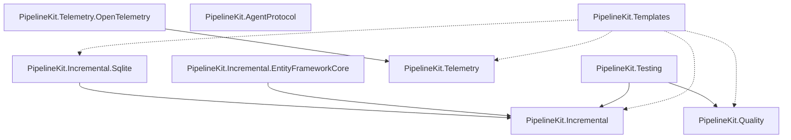
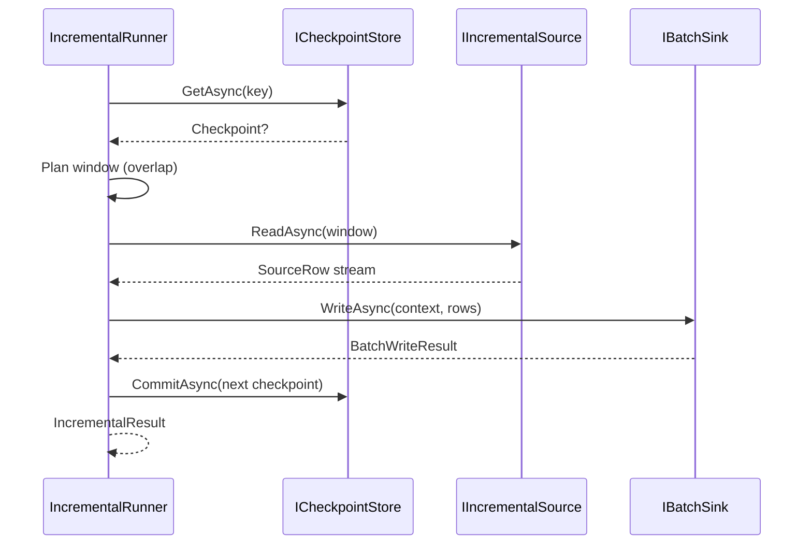
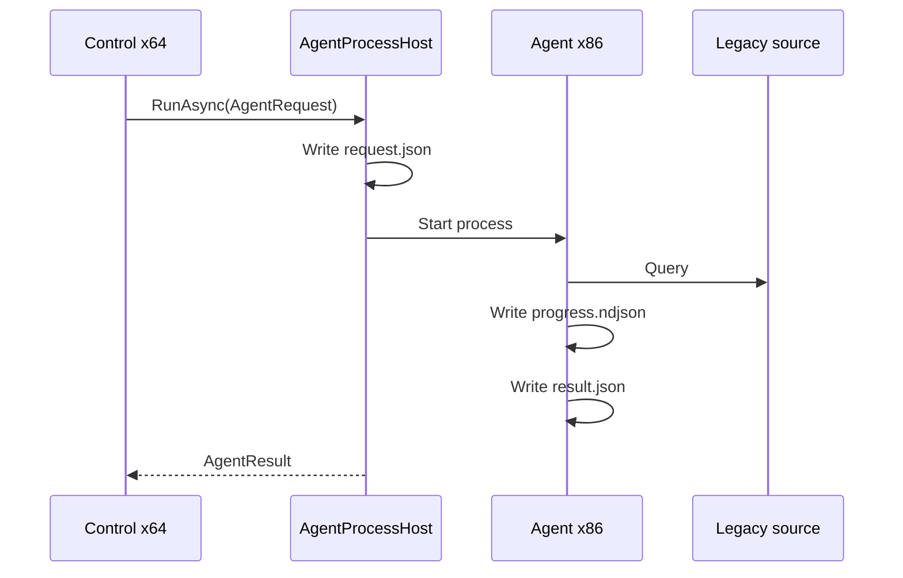

# Architecture

PipelineKit is a set of small .NET packages for incremental data pipelines.
It is deliberately not a framework: you compose the pieces you need.

## Design goals

1. **Never lose a committed position.** A checkpoint advances only after the
   sink succeeds.
2. **At-least-once delivery.** Retries are expected; sinks must be idempotent.
3. **Small packages.** Adapters for databases, brokers and telemetry are
   separate from the core.
4. **Streaming first.** Large sources must not be materialized in memory.
5. **Observable by default.** Stable trace and metric names for batches.
6. **Legacy-friendly.** The same contract works on .NET 10 and on a 32-bit
   .NET Framework agent when a legacy driver forces it.

## Package map



`AgentProtocol` has no dependency on the other packages. It targets
`netstandard2.0` and `net10.0`.

## Runtime flow



If the sink throws or does not consume the full stream, the checkpoint is not
committed. The next run re-reads the window.

## Packages

| Package | Responsibility |
|---|---|
| `PipelineKit.Incremental` | Checkpoints, windows, row hash, runner, in-memory store |
| `PipelineKit.Incremental.Sqlite` | SQLite checkpoint table |
| `PipelineKit.Incremental.EntityFrameworkCore` | EF Core checkpoint entity and store |
| `PipelineKit.Quality` | Rules, quarantine, schema drift, reconciliation |
| `PipelineKit.Telemetry` | `ActivitySource`, `Meter`, `PipelineScope` |
| `PipelineKit.Telemetry.OpenTelemetry` | Resource, tracing/metrics registration, OTLP/console exporters |
| `PipelineKit.AgentProtocol` | Versioned JSON contract and process host for isolated agents |
| `PipelineKit.Testing` | Fake source, collecting sink, dirty data, fixed clock |
| `PipelineKit.Templates` | `dotnet new pipelinekit-job` |

## Checkpoint semantics

A checkpoint is identified by:

```
pipeline + source + table + strategy
```

Strategies:

- `TimestampAndKey`: timestamp is the primary filter; the key is a tie-breaker.
  The next window starts at `lastModified - overlap`.
- `Key`: `key > lastKey`.
- `Period`: period identifier such as `AAAAMM`.
- `Snapshot`: the source decides what to return.

The runner keeps the **maximum** key, timestamp and period seen. A late update
with a lower key therefore cannot make the checkpoint go backwards.

## Idempotency

The sink is responsible for idempotency. The recommended pattern is:

1. A natural key for the row.
2. A stable hash of the row values (`RowHasher`).
3. `UPSERT` on the natural key.
4. Skip the write if the stored hash is unchanged.
5. Commit the checkpoint only after the write transaction commits.

`BatchWriteResult.RowsUnchanged` exposes how many rows were re-read but not
changed.

## Quality and quarantine

`QualityEvaluator` runs a list of `IQualityRule` against each row. Invalid rows
can be written to an `IQuarantineStore` with the original value, rule, message
and batch id. Quarantine is evidence, not a silent truncation.

`SchemaDriftDetector` compares an expected schema with the actual one.
`Reconciliation` compares counts and sums between source and target.

## Outbox

The LegacyBridge sample writes an `orders.batch.loaded` event to an `outbox`
table in the same transaction as the batch. `OutboxRelay` publishes pending
events and marks them processed.

- Without `RABBITMQ_HOST`, events go to `messages.ndjson`.
- With `RABBITMQ_HOST`, events go to a durable topic exchange and a durable
  queue.

`LegacyBridge.Consumer` consumes the queue, stores each message id in SQLite
before acking and acks duplicates without reprocessing. Delivery is
at-least-once; the inbox table provides idempotency.

This is the anti-corruption boundary: future services consume events, not the
legacy schema or the staging tables.

## Agent isolation



The control process never loads the legacy driver. The contract is plain JSON,
debuggable with files, and works with a .NET Framework 4.8 x86 agent.

## Telemetry conventions

| Signal | Name / tag |
|---|---|
| Activity | `pipeline.batch` |
| Source/Meter | `PipelineKit` |
| Tags | `pipeline.name`, `pipeline.source`, `pipeline.table`, `pipeline.country`, `pipeline.stage` |
| Trace-only | `pipeline.batch_id` |
| Counters | `pipeline.batches`, `pipeline.rows.extracted`, `pipeline.rows.rejected`, `pipeline.failures` |
| Histogram | `pipeline.duration` (ms) |

Never use `order_id`, `customer_id` or other high-cardinality identifiers as
metric labels. Put them in traces and logs.

## Testing

- Unit tests per package.
- Integration tests for the LegacyBridge pipeline.
- CI on Linux and Windows.
- Windows CI publishes and runs the sample as `win-x86`.
- CI installs the template, generates a project, restores it and runs it twice.

## Versioning

Semantic version `0.x`. Packages are published to GitHub Packages when a `v*`
tag is pushed. See [PUBLISHING.md](PUBLISHING.md).
