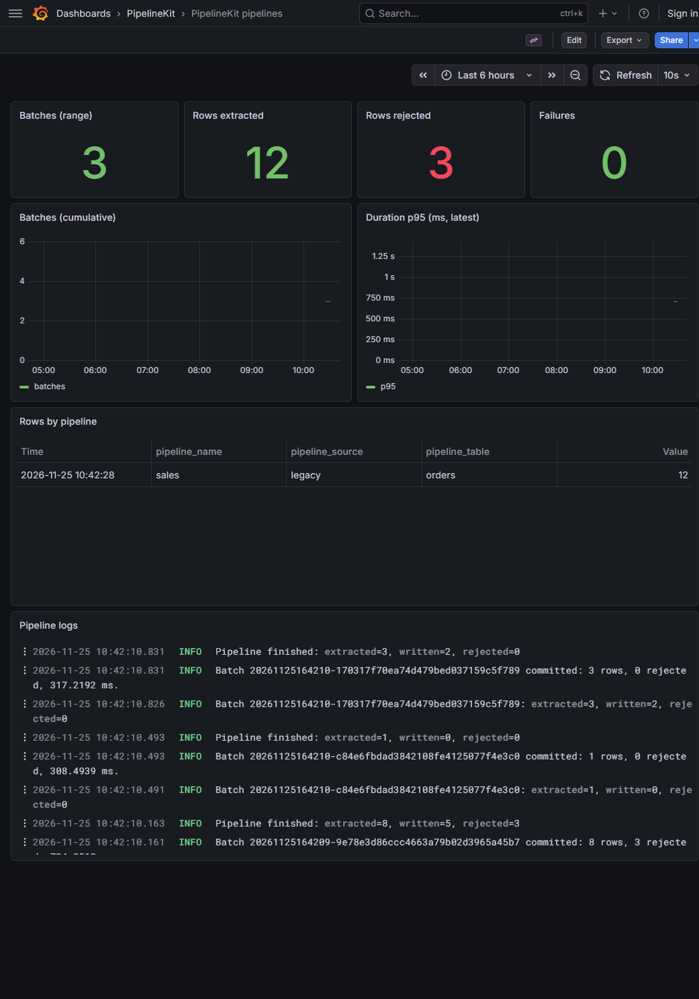

# PipelineKit documentation

Reusable .NET building blocks for incremental, observable and testable data
pipelines.

## Start here

- [Handover](handover.md)
- [Roadmap to 1.0](roadmap-1.0.md)
- [How it works](como-funciona.md)
- [Architecture](architecture.md)
- [Code guide](code-guide.md)
- [IncrementalRunner deep dive](incremental-runner.md)
- [Publishing](PUBLISHING.md)
- [Mutation testing](mutation-testing.md)
- [ADRs](adr/README.md)

## Repository

- [README](https://github.com/DanielCB096/pipelinekit/blob/main/README.md)
- [LegacyBridge sample](https://github.com/DanielCB096/pipelinekit/blob/main/samples/LegacyBridge/README.md)
- [Observability stack](https://github.com/DanielCB096/pipelinekit/blob/main/observability/README.md)
- [Benchmarks](https://github.com/DanielCB096/pipelinekit/blob/main/benchmarks/RESULTS.md)
- [Job template](https://github.com/DanielCB096/pipelinekit/blob/main/templates/pipelinekit-job/README.md)
- [Plan de renombrado del repositorio](rename-repo.md)
