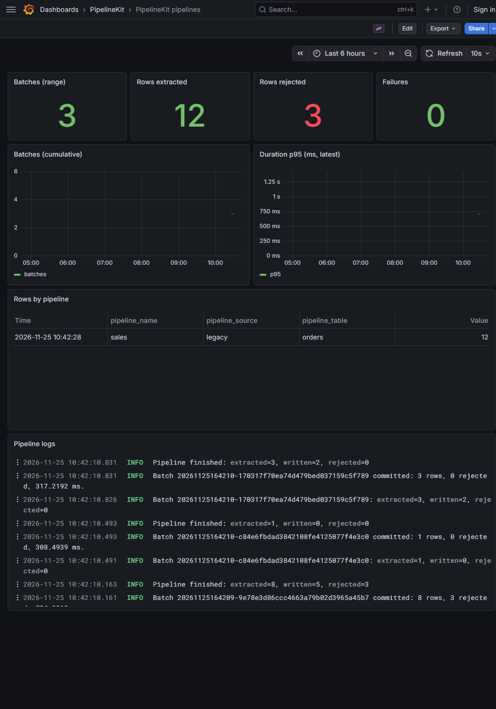

# Observability stack

Collector + Tempo + Prometheus + Loki + Grafana for PipelineKit pipelines.

## Start

```bash
docker compose -f observability/docker-compose.yml up -d
docker compose -f observability/docker-compose.yml ps
```

| Service | URL |
|---|---|
| Grafana | http://localhost:3000 |
| Dashboard | http://localhost:3000/d/pipelinekit |
| Prometheus | http://localhost:9090 |
| Tempo | http://localhost:3200 |
| Loki | http://localhost:3100 |
| Collector health | http://localhost:13133 |



The dashboard shows batches, extracted and rejected rows, failures, duration
p95, rows by pipeline and logs. The collector keeps metric series for one hour
(`metric_expiration: 1h`).

## Send telemetry from the sample

Set `OTEL_EXPORTER_OTLP_ENDPOINT`; without it the sample uses the console exporter.

```bash
OTEL_EXPORTER_OTLP_ENDPOINT=http://localhost:4317 \
  dotnet run --project samples/LegacyBridge/LegacyBridge.Control -c Release -- --reset
```

The control emits:

- traces `pipeline.batch` to Tempo,
- metrics `pipeline.*` to Prometheus,
- structured logs to Loki.

## Queries

Prometheus:

```promql
sum by (pipeline_name) (increase(pipeline_rows_extracted_total[$__range]))
histogram_quantile(0.95, sum by (le) (rate(pipeline_duration_milliseconds_bucket[$__rate_interval])))
```

Loki:

```logql
{service_name="legacybridge"}
{service_name="legacybridge"} |= "Pipeline finished"
```

Tempo: Explore → Tempo → `{ resource.service.name = "legacybridge" }`.

## Stop

```bash
docker compose -f observability/docker-compose.yml down
```

Add `-v` to remove the volumes.
